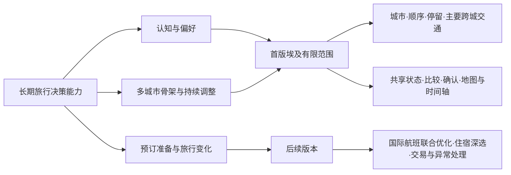
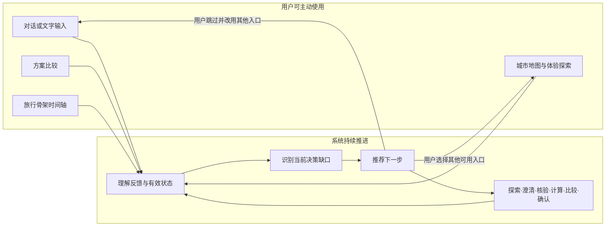
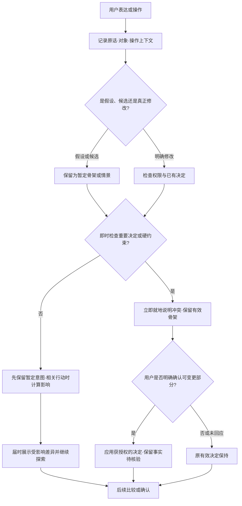

# AI Native旅行产品｜PRD V0.1

**文档状态：** 产品需求基线；数据覆盖与用户效果待验证  
**版本：** V0.1；UX-02 同步修订 2026-11-05  
**依据：**《AI Native旅行产品｜项目思考总纲 V2》为最高产品基线；历史讨论的已确认结论按第 7.5 节追踪。UX-02 V0.1 于 2026-11-05 获 Owner 验收，相关行为按原需求 ID 在本版同步；历史原 Chat 未完整取得的证据限制仍以 UX-02 来源说明为准。

## 1. 产品概述与目标

### 1.1 产品定位

面向高决策自主需求、低规划劳动意愿的中国境外自由行用户，提供 AI 主导规划过程、用户保留关键价值判断权的旅行决策系统。

系统帮助用户从陌生目的地认知和渐进式偏好探索出发，逐步形成可理解、可取舍、具有现实可行性依据的多城市旅行骨架。旅行骨架至少包括城市组合、顺序、停留分配、主要跨城交通、选择依据及尚待核验事项。

### 1.2 目标用户与核心任务

目标用户希望自主决定重要旅行体验，但不愿独自承担大量信息搜索、整合、核验、比较和反复规划的劳动。这里的“低价值”指用户亲自完成重复整理的价值低，不指核验和比较本身不重要。首要设计对象为 V2 定义的轻量自主规划者。

核心任务：用户计划前往陌生境外目的地进行多城市自由行时，AI 主动协助探索目的地、理解偏好、结合现实约束比较与调整方案，使用户能够以较低规划劳动形成自己理解并认可、且有可行性依据的旅行骨架。

### 1.3 产品目标与原则

- 让用户在还不能准确表达偏好或预算时也能开始获得帮助。
- AI 承担决策准备、信息组织、约束计算和工作流推进；用户保留关键价值取舍、重要目标变化及高风险操作的控制权。
- 多种交互入口共享持续更新的旅行状态。系统根据当前决策缺口推荐下一步，用户可以跳过推荐并主动采用其他入口。
- 大语言模型（LLM）可理解语义、提出下一步行动和解释结果；重要行为受旅行状态、外部事实、业务规则及行动权限约束。
- 方案解释必须来源于有适用条件的资料、查询或计算结果；允许带待核验项的暂定骨架，但关键缺口要出现在其影响的位置。

> **核心思想：** 目的地认知、偏好形成和方案构建始终与现实条件共同推进。凡某项外部事实足以改变用户眼前的理解、兴趣或选择，系统应在相关决策点及时核验并呈现其适用条件；无法核验时明确标出未知。用户确认的是自己的价值选择，不能把未经证实的现实条件“确认”为真。

### 1.4 成功结果

用户理解并认可一套旅行骨架，知道城市组合、顺序、停留、主要跨城交通、所获体验与代价，以及哪些条件已核验、哪些仍待核验。“用户认可”和“现实可行性已证实”分别记录。后续验证观察任务完成、决策质量与理解、规划劳动、状态可靠性和实际使用选择；本版不预设未经测量的提升目标。

## 2. 产品范围与版本边界

### 2.1 长期产品能力

长期产品是一套持续的旅行决策系统：支持陌生目的地认知、偏好形成、多城市骨架、预订准备及旅行中的变化处理；持续维护城市、国际出入境、交通、住宿、体验、预算和订单之间的关系。用户可以从探索或已有条件进入，并在方案形成后回到探索。AI 组织决策准备，用户决定重要取舍；服务范围将通过真实任务验证逐步扩展。



图表示能力边界；首版的数据范围不会反向缩小长期产品定位。

### 2.2 首版最小可行产品（MVP）目标与范围

MVP 以埃及多城市自由行为示例场景，完成从认知探索、偏好形成、方案比较到旅行骨架确认和多轮修改的产品闭环。首版技术实现范围限定为经工程验证后选定的有限埃及城市集合及其核心跨城连接；具体城市、交通方式、数据提供方和覆盖水平需经验证后登记，不在本 PRD 中假定已可用。

用户提供国际入境和离境地点、日期与时间等条件。产品在这些条件范围内支持城市组合、顺序、停留分配和主要跨城交通判断。用户尚未提供完整条件时仍可探索；依赖缺失条件的可行性结论必须标明限制。

MVP 纳入：

- 渐进式目的地认知和偏好探索，交互形式可迭代，不限定为卡片。
- 旅行状态维护、用户纠错、候选与确认决定区分。
- 根据决策缺口推荐交互或行动，支持用户跳过并改用其他入口。
- 多城市旅行骨架候选、方案比较及基于实际差异的取舍说明。
- 地图、旅行骨架时间轴和对话等持续可调用的工作空间入口。
- 多轮修改、影响判断、有限范围重算、关键变化确认。
- 预算意向的渐进形成、明确上限的保护、可核验分项费用与缺项说明。
- 与当前选择相关的适用条件及时提示；MVP 覆盖范围内的真实交通信息核验与不确定性说明。内容及交通数据覆盖均待工程验证。
- 保存当前旅行骨架及其决定依据和变更记录；跨会话恢复最后成功保存的任务、焦点与未完成编辑，恢复后重读当前旅行状态和事实，不恢复旧授权。
- 查看历史版本，并支持整份或指定城市的历史安排恢复：先预览当前条件下的连锁影响，用户作出必要决定后以新版本生效；保留原历史。两种恢复均为 MVP，依据 2026-11-05 Owner 裁决。

### 2.3 未来版本与明确不承诺

首版不实现国际机票实时搜索或国际航班联合优化、酒店深度选择、酒店与航班联合优化、预订支付、改退及完整订单生命周期管理。逐日景点排程和旅行中异常处理不作为本版交付；可使用必要的体验信息判断城市停留价值。未来若推荐具体酒店、餐厅或交易方案，必须先具备足以支持该建议的预算与适用条件，不能从本版能力推定已有此功能。

产品不承诺全目的地、全日期、全交通方式实时覆盖；不把地图连线、估算耗时或工具返回成功等同于真实班次存在或可购买。预算比较必须说明人数、币种、日期、费用包含项和缺项；首版不输出缺乏依据的全程总价。更完整的费用估算属 P1。

## 3. 核心用户流程与交互

### 3.1 持续决策循环

用户可以从模糊目的地意愿、已知旅行条件或已有候选开始。系统结合有效旅行状态和最近反馈，识别眼下阻碍判断的是选择参照、价值取舍、现实条件还是状态误解，再推荐适合的交互或行动。认知、决策与执行三类不确定性是判断缺口的视角，不是用户必须顺序通过的阶段。用户可采纳、跳过，或主动进入其他可用入口；推荐不构成流程门槛。

典型行动包括目的地探索、必要澄清、事实查询、约束计算、方案比较、请求确认或说明当前阻碍。行动结果、用户反馈和新事实继续更新旅行状态；认知探索与规划比较可来回切换，不要求完成固定步骤或问卷。



箭头表示可反复进入的任务循环，不表示用户必须按图中次序操作。重要决定仍按第 5.3 节的权限边界处理。

### 3.2 交互入口

- **对话／文字输入：** 表达开放需求、条件、理由、纠正和修改意图。语音可作为未来或具备条件时的替代入口，本版 P0 不以语音识别为验收前提。
- **城市地图与体验探索：** 陌生目的地启动时默认联动展示有限范围内的城市位置、独特体验与差异；支持轻量反馈及可选的“喜欢什么／担心什么”补充。具体卡片、滑块或其他控件不预先定死。
- **方案比较：** 展示有实际差异的候选、获得与放弃、时间和交通影响及未知项。
- **地图与时间轴：** 展示空间关系、旅行顺序和停留分配，并允许用户直接操作；在任务全过程可反复调用。

这些入口共享旅行状态和同一份编辑草稿；浏览焦点、当前编辑目标与有效方案须可区分。具有业务含义的表达或操作须保存对象与上下文、参与后续理解和行动选择，但不要求每次拖动都实时调用 LLM；可确定的事件先由程序记录和校验，语义有歧义或需要选择行动时再由模型参与。系统推荐的入口以稳定布局中的突出态呈现，并说明目的；用户改用其他入口后恢复普通态。具体高亮、色彩和尺寸效果留给交互验证。

### 3.3 用户操作与确认

明确操作先被记录为带上下文的操作意图。收藏、浏览或拖动可作为线索，但不自动升级为稳定偏好、候选确认或最终决定。连续、不涉及即时核心冲突的拖动与停留调整累积为一份**暂定骨架**，原有效方案保持不变；系统不主动弹出解释，待相关行动受影响时展示差异。若操作触及已确认城市、明确硬约束或重大价值取舍，系统立即就地说明冲突与影响，保留待确认状态，允许继续编辑；未经相应授权不应用重要变更。用户确认价值选择，不能确认外部事实为真。已展示对象、版本、重要取舍及未知范围后，用户明确选择方案或完成一组编辑可构成对应范围的确认，无须重复泛化确认；新出现的重要牺牲仍须另行说明并取得授权。

### 3.4 关键界面与状态示意

以下是共存关系示意，不预设最终页面布局或控件样式：

```text
同一旅行工作空间
  当前理解／待核验条件
  城市地图与体验  ·  对话  ·  时间轴  ·  方案比较   ← 均可主动进入
  推荐下一步：查看两座城市的体验差异〔原因：选择参照不足〕
  暂定骨架／有效骨架及与当前问题相关的事实、费用缺项
```

| 状态 | 用户可见行为 | 状态与权限 |
|---|---|---|
| 系统推荐某入口 | 该入口突出并说明原因，其他入口仍可使用 | 不要求完成推荐操作 |
| 用户跳过并改用其他入口 | 原推荐恢复普通态，处理用户新输入 | 不丢失原有旅行状态；重新判断缺口 |
| 无核心冲突的连续调整 | 直接操作结果留在暂定骨架，暂不弹解释 | 保留原有效骨架及每次操作意图 |
| 触及重要决定或硬约束 | 就地说明影响并提供确认路径 | 未确认前不改写有效决定；不可更改的硬约束仍有效 |
| 当前事实缺失或失效 | 在相关内容、交通连接或费用旁显示未知与影响 | 不借用户确认把未知改成已核验 |

## 4. 详细功能需求

优先级定义：**P0** 为完成 MVP 核心任务的必要需求；**P1** 为可在核心闭环之后增强的能力；**未来版本** 为超出本版边界的能力。本章规定用户可见行为、约束和验收；第 5 章规定 AI 行为边界，第 7.6 节把具体状态结构、行动规则和评测交给技术附件。数据供应商、存储方式与框架选型属后续工程实现。

### 4.1 P0 需求

#### PRD-001｜低门槛启动与渐进式认知探索

- **用户场景：** 用户想去埃及，但不了解有哪些城市、体验及其差异，也不能准确表达偏好。
- **触发条件：** 用户首次表达目的地意愿；在后续比较中说“不知道区别”“想再了解”，或新事实改变原有兴趣。
- **输入：** 目的地意愿、已有旅行状态及用户主动提供的任何时间或约束信息。
- **系统行为：** 只凭目的地意愿即可开始。默认用有限城市地图与体验内容建立空间和内容参照系：城市在哪里、各自提供什么差异化体验、加入本次旅行可能带来什么条件或代价。根据已知日期、天数或其他条件调整内容；不强制完整问卷。轻量反馈可标记兴趣、排斥或待看，旁边提供可跳过的“喜欢什么／担心什么”补充；保留用户原意和条件，不把单次行为直接当稳定偏好。只有相关事实足以改变当前理解或选择时才触发及时核验，按 PRD-007 处理。城市点击、详情浏览和轻量兴趣反馈分别处理；兴趣不自动采用城市或体验，浏览其他城市不结束原任务。
- **输出：** 带位置与体验差异的可理解候选、反馈及条件的当前理解、下一步可探索方向与相关未知项。
- **异常处理：** 内容来源或适用条件不足时标明未知；反馈含糊且会改变重要决定时针对性澄清；用户不继续探索时允许转入任何可用入口。
- **验收条件〔A01〕：** 只说“想去埃及”即可看到有差异的城市与体验；用户可不填预算和日期继续探索；若采用卡片式反馈，可同时喜欢多项或全部不喜欢，该规则不强加于其他形式；“感兴趣，但怕转场累”保存兴趣与顾虑，浏览或单次喜欢不确认城市；点击另一城市只切换查看焦点，不改变正在处理的原任务或有效方案。
- **技术追踪：** Trip State Schema（状态模型）：兴趣、顾虑、条件与候选来源；Next Action Policy（行动策略）：探索／澄清／核验；AI Evaluation（评测）：反馈语义、适用事实与下一步选择。

#### PRD-002｜统一旅行状态与用户纠错

- **用户场景：** 用户通过多轮对话、探索操作和方案修改逐渐补充条件，或发现系统理解错误。
- **触发条件：** 任一具有旅行业务含义的表达、选择或修改发生；用户主动纠错。
- **输入：** 用户原话或操作事件、事件发生时的对象与任务上下文、当前有效状态和相关外部事实。
- **系统行为：** 区分旅行目标、偏好、候选、约束、骨架、确认决定、外部事实与未解决问题；为重要内容保留来源、明确程度、重要程度、适用范围、条件、排除或重新考虑的理由及更新历史。先形成候选状态变更，经业务校验后才合并有效状态。对纠错识别被修正的原意图或对象，避免把“不是三天，是两天”累计执行两次；跨会话保留最后成功保存的工作现场及未提交草稿引用，恢复后以最新有效状态重建上下文，旧授权和旧事实核验资格不复活。完整旅行状态保存整趟旅行的信息；当前决策上下文从有效状态选取本步所需内容，必须包含适用硬约束，不成为第二份独立真相。以易理解的摘要让用户纠错。
- **输出：** 当前有效状态、暂定或待确认内容、变化依据及用户可理解的状态摘要。
- **异常处理：** 推断、系统默认或最新一句话不得覆盖已确认决定；假设讨论不应用到有效状态；范围不清且影响重大时先澄清；更新失败时保留原状态并提示。
- **验收条件〔A02〕：** 收藏不等于确认；“如果少两天”只建立假设；明确更正日期后旧值与理由可追溯，依赖旧日期的结论标记重查，其他决定保留；暂时排除的城市在相关条件变化后可重新进入候选；更正“不是三天，是两天”不会累计两次；新会话从最后成功保存的任务/草稿继续，旧授权不复活。
- **技术追踪：** Trip State Schema：对象、条件、来源、变更与决策上下文；Next Action Policy：冲突澄清和状态应用边界；AI Evaluation：提取、纠错和多轮一致性。

#### PRD-003｜根据决策缺口推荐下一步

- **用户场景：** 用户可能需要了解选择差异、补充关键条件、核验交通、比较方案或作出重要选择。
- **触发条件：** 用户输入／操作或工具结果使当前旅行状态发生变化，或当前任务仍有未解决缺口。
- **输入：** 旅行目标、当前决策上下文、候选及有效约束、反馈原因、可用数据与工具、行动权限。
- **系统行为：** 根据缺口选下一步：不知城市差异则解释差异；都想去且时间不足则比较取舍；对转场代价不明则查询或计算；已知代价仍难选则帮助梳理价值排序；理解错误则先纠错。AI 比较行动的当前价值、条件与用户负担；可先准备事实，也可等待或不介入，不能因存在缺失字段就固定追问。推荐入口在稳定布局中突出并说明原因，其他入口始终可用。用户跳过或改道后恢复普通态，接纳新输入并重新判断缺口；不因一次“都喜欢”自动扩大探索。信息齐备且范围支持时，相关事实可按 PRD-007 主动核验。
- **输出：** 一项与当前缺口对应的建议行动、原因、所需条件或结果，以及可用替代入口。
- **异常处理：** 只追问会改变眼前判断的缺失条件；若没有可靠行动或工具不可用，说明阻碍与可继续的方向；用户跳过不丢失已有信息。
- **验收条件〔A03〕：** 面对“这几个城市有什么区别”推荐差异解释；面对“喜欢但怕折腾”推荐核验代价而非泛化卡片；用户跳过推荐并改用文字或地图输入后，原推荐突出态退出、状态连续且已知条件不重复询问；缺口存在但行动价值不足时可等待或不介入。
- **技术追踪：** Trip State Schema：决策上下文和缺口；Next Action Policy：行动候选、优先顺序、权限与用户改道；AI Evaluation：不同缺口选不同动作及跳过后的连续性。

#### PRD-004｜城市骨架候选、比较与取舍解释

- **用户场景：** 用户需要决定埃及城市组合、顺序、停留时间和主要跨城交通。
- **触发条件：** 当前状态已足以形成有意义的比较，或用户明确请求生成／比较骨架。
- **输入：** 可用天数、用户提供的国际入离境条件、候选与已确认城市、偏好和预算表达、硬约束、覆盖范围内的交通事实及缺口。
- **系统行为：** 在已知边界内形成实质不同的骨架，检查硬约束。存在多个有意义的候选时默认先比较两项，用户可展开更多；比较包含获得与放弃的体验、城市顺序和停留、门到门时间或其缺失、转场复杂度与疲劳线索、有依据的分项费用、对其他城市的影响及待核验条件。系统可说明有依据的推荐理由，不能用不透明综合分代替用户价值判断；用户可以选较费时但更符合其期待、且不违背已知硬约束的候选，现实可行性仍按核验层级说明。
- **输出：** 可比较的城市组合、顺序、停留、主要交通与分项代价；每项结论旁显示核验层级、假设及未知，不把有待核验的骨架称为完全可执行。
- **异常处理：** 仅一种有意义方案时不凑第二项；缺数据时区分暂定比较与已核验比较；全部候选违反硬约束时列出冲突，不自行放宽用户条件。
- **验收条件〔A04〕：** 两项候选在安排或取舍上有实质差异，费用只合计口径一致且有依据的项目；用户能说出各方案得到与放弃什么、费用和时间哪些尚未知；无可行方案时明确冲突而非伪造可行解。
- **技术追踪：** Trip State Schema：骨架版本、假设和费用依据；Next Action Policy：候选生成、比较及进一步澄清；AI Evaluation：约束、费用口径、计算与解释一致性。

#### PRD-005｜地图与旅行骨架时间轴

- **用户场景：** 用户需要同时理解城市位置关系、行程顺序和停留安排，并可直接调整计划。
- **触发条件：** 用户打开地图／时间轴，或系统认为空间、顺序或时间视图有助于当前决策。
- **输入：** 有效骨架、城市与连接、停留分配、地图／时间轴操作及操作时的旅行上下文。
- **系统行为：** 地图和时间轴与其他入口共用旅行状态，可随时打开。记录拖动对象、原位置、新位置、顺序和上下文，作为操作意图；地图、时间轴与明确的对话修改共用一份有基础版本的暂定骨架；连续操作累积其中，不由浏览、拖动推断稳定偏好或最终决定。确定的结构变化及时反馈，复杂事实和全程影响可异步聚合，结果必须关联发起时的对象和版本。无即时核心冲突时允许直接编辑，不主动弹解释；后续相关比较、核验或修改受其影响时再计算并展示差异。若触及重要决定或明确约束，按 PRD-008 就地提示并待确认。
- **输出：** 城市空间关系、骨架时间轴、暂定编辑结果与需要时才出现的影响差异；原有效骨架仍可对照。
- **异常处理：** 地图连线或缺失时间不得被当成真实交通可行性；地图服务不可用时保留其他入口和有效状态，并将地图能力记为未通过验收；操作造成冲突时保留有效骨架、说明受影响对象并允许继续调整暂定骨架。
- **验收条件〔A05〕：** 连续移动两个城市、调整一晚停留后可追溯每项操作和累积结果；原方案未被替换；下一次受影响比较展示总差异；拖动不产生“必须去”偏好或真实班次结论；地图、时间轴和明确对话修改共用同一草稿，过时异步结果不覆盖新版本。
- **技术追踪：** Trip State Schema：操作事件、暂定与有效骨架；Next Action Policy：影响识别、延迟展示和冲突提示；AI Evaluation：连续拖动、误推断与决定保护。

#### PRD-006｜多轮修改与有限范围重算

- **用户场景：** 用户新增或移除城市、调整停留、缩短天数或更正入离境条件后，需要理解新旧骨架差异。
- **触发条件：** 用户明确提出修改、连续暂定编辑影响已有方案，或关联的外部事实发生变化。
- **输入：** 修改或假设意图、有效及暂定骨架、确认决定、硬约束与关联事实。
- **系统行为：** 先识别受影响关系，在 MVP 有限范围内重算相关骨架，必要时重算整份骨架；保留无关决定和原版本。呈现获得与失去、时间和有依据的费用差异、冲突以及失效或待重查的事实。明确区分当前有效方案 A、未提交草稿 B 与有明确基准的假设预览 C；“如果少两天”只生成 C，“改成少两天”才构成修改意图。C 可基于 A 或 B，查看 C 不覆盖 B/A；重要替换按 PRD-008 的具体授权边界处理。
- **输出：** 调整候选、相对有效方案的影响、事实有效性和用户可接受或保留原方案的选择。
- **异常处理：** 超出计算或数据覆盖时标出未重算部分；缺必要条件时只追问该条件；无可行候选时保持原有效方案并说明冲突。
- **验收条件〔A06〕：** 缩短天数只重算受影响结果，未受影响决定保留；假设不改写有效天数；已确认城市不被静默移除；用户接受重大变更后才更新有效骨架及依据；基于有效版或草稿的假设预览不自动采用，纠错不重复叠加旧指令。
- **技术追踪：** Trip State Schema：依赖、版本和替代关系；Next Action Policy：影响分析、重算与确认；AI Evaluation：状态保持、假设处理和局部重算。

#### PRD-007｜相关现实条件与交通事实核验

- **用户场景：** 用户在探索某体验或比较城市骨架时，现实条件可能改变眼前的理解与选择。
- **触发条件：** 体验适用日期、交通连接、费用等事实足以影响当前判断；或者既有事实因条件变化可能失效。
- **输入：** 当前问题、用户已给日期等条件、城市或交通节点、可用来源或接口及其返回信息。
- **系统行为：** 对有可靠来源、数据能力覆盖且查询条件齐备的相关事实主动核验，无须等待最后确认；在事实影响的体验、交通连接或费用旁展示来源、日期、适用范围与时效。日期未提供时可给有出处的概略信息，但不得伪装成该日期已核验。交通须区分地理连接、估算时间、指定日期班次和可购买性；只报告已达到的层级。体验开放等其他条件仅在有可核验来源时作事实表述。
- **输出：** 当前决策可用的事实、核验层级、适用条件、未知和对选择的影响。
- **异常处理：** 区分查询失败、空结果、字段缺失、资料过期、条件不适用与证实无服务；不能从失败推出“体验不开放”或“没有班次”。来源无法覆盖时就地标未知，并说明还缺什么证据。已知冲突、未知、资料过期、部分计算和工具失败分别标示；会影响选择的冲突持续关联地图、时间轴及说明区中的对象，不能因关闭提示而消失。
- **验收条件〔A07〕：** 某体验是否适用于旅行日期会改变用户兴趣时，系统有条件则核验并就近说明；无可靠数据则标未知。交通接口超时不被写成无班次；估算不显示成真实班次；旧日期的事实不继续作为新日期的已核验依据；已知冲突、未知、过期及工具失败各自可辨，持续关联受影响对象。
- **技术追踪：** Trip State Schema：外部事实、条件、来源与失效；Next Action Policy：主动核验前置和失败分支；AI Evaluation：日期适用、空结果、超时、过期与误报。

#### PRD-008｜关键决定确认、保存与变更追溯

- **用户场景：** 用户选择骨架方案，或系统拟应用会改变重要旅行决定的调整。
- **触发条件：** 确认城市取舍、重要顺序／停留变化、硬约束变更或存在关键冲突。
- **输入：** 当前有效决定、待确认变更、原因、受影响对象、可行性依据及未知项。
- **系统行为：** 按第 5.3 节权限判断是否需要确认。重要冲突立即就地提示；说明将改变什么、为何、保留什么、还未知什么。用户明确选择已充分展示的候选或完成合法编辑时，该操作本身可表达对相应价值取舍的确认；出现先前未展示的重要牺牲时须另行取得具体授权。确认后保存版本与依据；已确认骨架可继续带明确的待核验项，但不能显示为全项可行。用户确认不授予预订、支付、改退权限，也不能把外部事实变成真。用户可在缺日期时确认当前层次的概念骨架，但日期相关可行性仍待核验；后补日期只重核验受影响对象。历史查看只读，整份和城市级恢复均须预览当前影响、取得必要授权并创建新版本，不能覆盖旧历史。
- **输出：** 有效骨架或仍待确认的暂定骨架、确认记录、旧版本及未解决事项。
- **异常处理：** 拒绝或未回应时保留原方案；确认对象含糊时先澄清；保存失败、提交超时或回执丢失时先查询权威结果，不虚报成功或失败，同一意图重复提交不得重复生效；旧草稿不得覆盖较新的有效版本；不可更改的硬约束无法满足时保持冲突，不能通过普通方案确认消除。
- **验收条件〔A08〕：** 移除已确认城市时即时显示影响但允许继续编辑，确认前原方案仍有效；拒绝后保留原方案；接受含待核验班次的骨架只记录价值选择与未知，不能记录“班次已证实”；明确选择已展示取舍无需普通二次确认；整份与城市级历史恢复均产生新版本，失败时当前有效版不变；提交结果未知和重复提交有安全反馈。
- **技术追踪：** Trip State Schema：确认范围、依据、版本与事实核验状态；Next Action Policy：权限和待确认动作；AI Evaluation：越权、拒绝、未知事实误升级。

#### PRD-009｜渐进式预算形成与约束检查

- **用户场景：** 用户不了解埃及花费，只说“大概两万元”，探索后可能愿意为特别重视的体验调整预算；也可能明确给出不能突破的上限。
- **触发条件：** 用户表达金额或费用顾虑；新增有依据的费用信息；骨架比较或修改会改变已知成本。
- **输入：** 用户原话、预算用途与适用范围、人数和币种、已知交通或体验费用、费用来源及未覆盖项目。
- **系统行为：** 不要求起始预算。区分未知、可调整的预算意向与用户明确的硬上限，记录变化理由和适用条件。对当前选择相关、可查证的费用给分项参考并注明日期、人数、币种、包含项和缺项；费用可能改变兴趣或选择时及时提示并允许用户调整价值排序。对明确硬上限检查已知冲突，不因部分费用未超限就宣称全程可负担；不擅自提高上限。首版不据此推荐具体酒店或餐厅，也不生成缺乏依据的全程总价。
- **输出：** 当前预算理解、可调整或硬上限状态、可比较的有依据分项及未知费用、必要的冲突提示。
- **异常处理：** 金额口径、币种、人数或范围不清时先说明限制，影响重要决定时澄清；无可靠价格不补造数字；仅部分项目已知时不得判断整趟旅行一定在预算内。
- **验收条件〔A09〕：** 初始无预算仍可探索；“大概两万”不成为硬约束，后续用户明确改为三万保留原因；“最多两万”在已知项目冲突时提示并请求用户决定，不自动放宽；只有交通和一项体验费用可查时，明确显示其余费用未知且不输出全程总价。
- **技术追踪：** Trip State Schema：预算状态、范围、来源和分项费用；Next Action Policy：何时提供费用参考、澄清和硬上限保护；AI Evaluation：预算修正、口径缺失、部分费用误当总价。

### 4.2 暂定变更、影响与确认流程

历史查看为只读。整份恢复以旧骨架为候选，城市级恢复只取指定城市旧安排；两者都先按当前约束、交通、总天数及已确认体验预览影响，合法授权后创建新版本，失败时保留当前有效方案。



图中“明确修改”仍需通过约束校验；用户不能确认不存在的班次或突破不可更改的现实条件。

### 4.3 P1 需求

| 需求 | 增量价值 | 依赖与延后原因 |
|---|---|---|
| PRD-101 更丰富的探索形式 | 试验卡片、情境选择、滑块、语音等形式对认知与反馈质量的影响 | 依赖 P0 状态语义与行动评测；首版先验证地图与体验联动，不锁定其余界面形式 |
| PRD-102 更广的目的地与交通覆盖 | 服务更多国家、城市、连接与日期 | 依赖数据来源、覆盖、时效、成本和许可验证；接口存在不等于核心任务可用 |
| PRD-103 更完整的预算估算 | 扩展住宿、餐饮等项目，支持总成本和预算敏感性分析 | 依赖费用来源及估算方法验证；P0 仅承诺有依据分项与缺口 |

### 4.4 未来版本

国际机票查询与入离境联合优化、酒店深度选择和联合优化、预订交易／改退、完整订单管理、旅行中异常监控和自动重规划均属未来能力。它们能让决策延伸到采购和旅中维护，但依赖更完整的实时数据、授权、订单与交易规则及真实用户需求验证，须另行定义，不能作为首版隐含承诺。

## 5. AI 系统行为需求与约束

### 5.1 语义理解与状态分类

系统应把用户表达和具有业务含义的操作理解为带来源、条件和适用范围的信息，不只累积偏好标签。最低限度区分：

| 信息类别 | 含义 | 示例 |
|---|---|---|
| 旅行目标 | 本次旅行要完成的任务与范围 | 想去埃及并形成多城市旅行骨架 |
| 用户偏好 | 明确表达或由行为推断的兴趣、排斥和优先级 | “喜欢这种体验，但不愿转场太累” |
| 候选 | 正在考虑、收藏或暂时排除的城市／体验／方案 | 收藏卢克索仍是候选；排除理由可被重新审视 |
| 约束 | 时间、预算、必须满足或不可接受的边界 | “最多两万元”与“大概两万元”含义不同 |
| 骨架方案 | 城市组合、顺序、停留和主要跨城交通 | 暂定骨架与当前有效骨架分别存在 |
| 确认决定 | 用户明确接受的方案或安排 | 确认城市组合和停留分配 |
| 外部事实 | 来自外部来源且带有适用条件和时效的信息 | 某日期某交通连接的查询结果 |
| 未解决问题 | 缺失条件、冲突及其影响 | 某连接缺少指定日期班次依据 |

同一对象可关联多种信息；不同类别不得相互自动升级。反馈的“显式或隐式”与“是否包含真实取舍”是两个独立维度：明确点击喜欢是轻量兴趣，浏览地图通常只是弱线索，“若交通太累就不去”是有条件的取舍。条件性表达保留条件；“如果少两天呢”只建立假设，除非用户明确要求应用。看过、感兴趣、加入候选、选中方案、确认决定和现实核验也不是一条对所有对象通用的单向状态链。

### 5.2 受控行动与完整旅行状态

**Trip State（完整旅行状态）**保存整趟旅行积累的有效信息及其依据；**Decision Context（当前决策上下文）**从中选取眼前判断所需内容。后者不能成为另一份独立真相，也不能漏掉适用硬约束。用户修改天数后，依赖旧天数的比较和事实须重新检查。


大语言模型负责理解语言、提出候选变更与行动、解释结果；资料检索与外部数据提供有出处的事实；程序规则和可检查的计算判断约束、时间、费用与权限；存储保存当前状态和变更依据；用户作重要价值取舍。结构化输出可约束数据形状，不能证明语义提取正确。调用工具前检查必需输入；工具结果按来源、条件和时效验证后回写状态，不把调用成功当成内容完整或真实可购买。首版采用轻量受控工作流，不预先引入复杂多智能体或 LangGraph（工作流编排框架）。

### 5.3 行动权限与确认边界

| 级别 | 首版典型行为 | 产品要求 |
|---|---|---|
| L0 信息辅助 | 展示城市差异、解释有来源的体验信息 | 可主动执行，事实仍标明适用条件 |
| L1 低风险调整 | 调整探索内容、生成候选和暂定比较 | 可自主执行，保留用户改动与原有效状态 |
| L2 重要方案调整 | 移除已确认城市、改变重要顺序或停留 | 先计算影响，就地提示，明确确认前不生效 |
| L3 高风险操作 | 变更用户明确硬上限、订单、支付或改退 | 明确授权与确认；订单及交易不属首版 |

是否需要确认，应结合错误影响、可逆性和信息可靠程度判断；三者不是已经验证的加权评分。相同的兴趣推断可用于调整探索内容，不能据此移除已确认城市。用户能控制的硬约束可在理解后明确变更；不可更改的现实条件及外部事实不能靠同意消除。确认对象须写明改变什么、保留什么、代价与未知；确认骨架不构成交易授权。

### 5.4 失败处理与状态更新

跨会话继续时，系统恢复最后成功保存的任务、焦点、比较对象和未完成编辑，再读取最新 Trip State 并检查事实时效；只恢复必要任务现场，不把旧提案、授权或模型推断重新当成当前确认。

- 查询超时、空结果、字段缺失、数据过期及确认无服务必须区分。
- 工具失败后保留原有效状态，不伪造结果；必要时说明当前可给出的估算层级及其限制。
- 无法满足全部硬约束时显式呈现冲突及可由用户选择的调整方向，不静默放松约束。
- 每次有效更新应有来源、适用范围和变化依据；新的兴趣、修正、替代、假设与未知分开处理，待确认提案不能提前写成有效决定。
- 操作意图应进入本轮及后续相关行动；旧结论若因条件变化不再适用须标记重查，未受影响的决定与事实保持有效。
- 用户可看到“目前理解你喜欢什么、哪些仍是候选、为什么暂未选择、哪些条件待核验”的简要状态，并可纠正。

### 5.5 草案锚定风险

“草案优先型容易被 AI 的第一份推荐锚定；如果初始草案不可靠，后续修改会建立在错误基础上。”这是本项目选择探索与规划双向联动的**设计风险判断**，不是已验证的用户研究结论。首份方案不呈现为默认正确；用户可以回到探索或主动比较替代方案。实际效果仍需用户测试验证。

## 6. 数据与非功能性要求

### 6.1 状态与事实数据要求

旅行状态需支持对象类别、当前业务状态、来源、明确程度、重要程度、适用范围、条件、时效、关联方案及变更依据。预算需区分初步意向与明确硬上限；操作意图、暂定骨架、有效骨架和确认记录需可分别识别。结构化字段、合法状态转换和存储方式由 Trip State Schema 附件定义；本章只规定产品语义。

外部事实至少应能关联查询条件、来源、查询时间、适用日期、结果状态及其支持或影响的方案。费用还需记录人数、币种、项目和包含范围。城市／地图操作需关联具体对象和当时旅行状态，避免把纯界面浏览误写为偏好。只有在来源、条件和核验层级足以支撑相应结论时，才可显示为该层级的“已核验”；用户认可方案不能提高事实核验层级。

### 6.2 非功能要求

- **可理解性：** 用户可查看当前重要偏好、约束、候选、确认决定和待核验事项，并能纠正系统理解。
- **可追溯性：** 重要决定、状态变化、外部事实和方案版本可关联其来源及适用条件。
- **一致性：** 地图、时间轴、对话和比较视图呈现同一份有效旅行状态，并清楚区分暂定内容；局部变化不得造成其他视图静默不一致。
- **隐私与安全：** 仅收集完成当前旅行任务所需的信息；凭据和敏感数据不得暴露在客户端或解释文本中；具体保留期限与合规要求需在工程设计阶段确认。
- **响应体验：** 系统应反馈正在执行的查询或计算，并在失败或等待时保留用户上下文；具体时延目标待技术验证后制定。
- **可观测性：** 运行记录能关联输入、状态前后差异、行动、规则检查与工具结果，定位语义理解、状态更新、查询或计算中的失败；不要求暴露模型内部思维过程。

### 6.3 明确待工程验证

埃及候选城市与核心连接清单、交通及体验条件的数据来源与许可、费用参考的覆盖和口径、数据时效与稳定性、接口配额与费用、地图服务可用性、城市及交通计算精度、状态保存与操作映射、隐私保留机制、响应时延及模型稳定性均待验证。验证结果可用于收窄 MVP 数据覆盖或改变实现方式，但不得把局部验证外推为全目的地能力，也不得将技术演示当成用户效果证明。

## 7. 验收标准与开发计划

### 7.1 端到端验收场景

| 验收编号／需求 | 场景输入 | 必须观察到的结果 |
|---|---|---|
| A01／PRD-001 | 只说“想去埃及”；随后对某体验表达兴趣及转场顾虑 | 可建立城市与体验参照；不逼预算／日期；兴趣与顾虑分开保存；卡片形式若使用，支持多选喜欢或全部不喜欢 |
| A02／PRD-002 | 收藏城市、问“如果少两天”、明确更正日期，并在另一会话继续未完成任务 | 收藏非确认；假设不覆盖有效天数；旧日期与变更原因可追溯；从最后成功保存点恢复任务/草稿，重读当前状态，旧授权不复活 |
| A03／PRD-003 | “城市看起来一样”与“喜欢但怕折腾”；用户跳过推荐改用文字或地图 | 两种缺口触发不同建议；行动价值不足时可等待；入口改道后突出态退出、状态连续、不重复问已知条件 |
| A04／PRD-004 | 有两个实质不同的城市骨架，且部分费用或班次未知 | 默认先比较两项，说明体验、顺序、停留、转场、已知分项费用与未知；不可行时解释硬约束冲突 |
| A05／PRD-005 | 在地图、时间轴与对话连续调整城市顺序与停留 | 三入口操作累积于同一暂定骨架；原有效骨架保留；确定性变化及时可见，后续比较呈现总差异，旧异步结果不覆盖新草稿 |
| A06／PRD-006 | 在有效版或草稿上问“如果少两天”，再说“确定少两天”，随后纠正原指令 | 假设有明确基准且不覆盖有效版/草稿；采用后重算受影响对象；纠错不重复叠加，已确认城市和无关决定不被静默删除 |
| A07／PRD-007 | 某体验的日期适用性可能改变兴趣；交通查询分别返回结果、空集和超时 | 在有条件和来源时主动核验并就近说明；已知冲突与未知持续关联对象；空集、超时、过期和证实无服务不混同 |
| A08／PRD-008 | 暂定编辑将移除已确认城市；用户先拒绝、后明确采用含待核验连接的骨架；随后分别尝试整份与城市级历史恢复 | 立即就地提示、原方案保持至获授权；明确选择已展示取舍可构成确认，拒绝不应用；待核验连接仍为未知；两种恢复先预览连锁影响并以新版本生效，失败不破坏当前有效方案 |
| A09／PRD-009 | 用户先说“大概两万”，后愿意调整；另一情景明确“最多两万” | 意向可更新并留原因，硬上限不被自动放宽；有依据分项注明口径和缺项，不输出全程总价 |

贯穿案例：用户从埃及目的地认知进入有限城市探索，对某体验产生带条件的兴趣；适用日期或交通代价在有可靠来源时及时进入判断，预算意向可随认知改变；系统形成有区别的骨架并解释取舍，用户可在地图和时间轴连续调整、比较并确认自己的选择。案例中的体验开放状态、路线、价格均作为**待查询条件或测试输入**，不预设其现实结果。

### 7.2 P0 验收门槛

- PRD-001 至 PRD-009 的逐项验收条件通过 A01–A09 及必要的多轮组合场景验证。
- 跨会话恢复检查最后成功保存点、最新旅行状态与事实重核验，旧授权不得复活；整份和城市级历史恢复分别验收。
- 关键失败类别单独检查：兴趣／候选／决定混淆、预算意向误变硬约束、硬约束被覆盖、待确认变更提前生效、外部事实层级夸大、工具失败伪装成功、部分费用冒充全程总价、无关状态丢失。
- 每项 P0 有可追踪的技术附件需求及评测用例；开放式行动允许多个合理结果，但必须满足规则边界。
- 技术行为通过、真实数据可用、目标用户获得价值分别形成结论；演示和发起人的熟练操作不能代替陌生目的地用户测试，也不代表市场需求或普遍覆盖已获证明。

### 7.3 第一阶段开发功能与验收清单

第一阶段交付一条可操作的**探索 → 状态保存 → 下一步建议**路径，同时完成一条埃及核心跨城连接的数据可用性验证。第一阶段不是完整 MVP；可用明确标识的测试资料验证产品机制，真实连接需单独留下来源和查询证据。

| 交付项 | 第一阶段验收出口 |
|---|---|
| 低门槛探索入口 | 只说“想去埃及”可进入有限城市地图与体验联动；用户可表达兴趣、顾虑或改用文字入口，不需先报预算 |
| 最小持续状态 | 保存原话、兴趣与条件、候选及来源；用户纠正后能看到更新，收藏不升级为确认；暂定预算不变硬上限 |
| 下一步行动 | 对“看不出差异”和“怕转场累”给不同建议；用户跳过推荐后仍接纳输入并恢复正常入口状态 |
| 最小评测 | 以上场景及误判、纠错、硬约束保护、工具失败各有预期与禁止行为；关键违规单独记录 |
| 数据可用性验证 | 为选定的一条埃及核心跨城连接记录城市／节点、交通方式、所查日期、来源、字段、时效、许可、费用与失败／空结果表现；不足以支持拟定核验层级时，该数据出口记为**未通过** |

第一阶段的小闭环通过不代表数据出口通过；数据出口未通过时不得宣称真实交通核验已具备。具体城市连接和供应商由验证证据确定，不在本文假定现成覆盖。

### 7.4 后续 MVP 开发依赖与出口

| 阶段 | 主要依赖与产出 | 出口 |
|---|---|---|
| 2. 统一状态与工作空间 | 完整状态、当前决策上下文、地图／时间轴操作与其他入口联动；扩展三份技术附件 | 多入口使用同一有效状态，暂定与确认内容不会混淆 |
| 3. 骨架与事实能力 | 有限城市组合、顺序、停留、主要交通及有依据分项费用；相关事实查询和有限范围重算 | 两项实质候选可比较，费用和交通结论只达到已核验层级；失败能正确退回未知 |
| 4. 端到端 MVP 验收 | 连续编辑、影响分析、重要确认、保存、整份/城市级历史恢复与拒绝路径；目标用户任务测试 | A01–A09 和组合场景留有测试结果，数据限制与用户价值结论分别报告 |

阶段可并行验证，但不能以某个演示代替全部阶段出口；不设未经测量的工期或提升百分比。

### 7.5 历史结论—需求—验收—附件追踪

来源简称：**V2**＝《AI Native旅行产品｜项目思考总纲 V2》；**机会1**＝《产品机会定义1知识归档》；**机会2**＝《产品机会定义2知识底稿》；**机制1**＝《产品机制设计1｜聊天知识归档》。下表覆盖已确认的 H01–H17，并补记机制1中会改变文档边界的 H18–H20。**S／P／E** 分别指第 7.6 节的状态模型、行动策略、评测附件；“—”表示该行是长期边界或写作原则，不单独增加首版技术对象。

| 历史结论 | 主要来源 | PRD 去向 | 验收 | 附件 |
|---|---|---|---|---|
| H01 空间与内容共同建立选择参照 | 机会1 §2.2；V2 §1.1.1 | §3.2、PRD-001 | A01 | S／P／E |
| H02 认知中的预算可形成和修正 | V2 §5.3；本轮已确认取舍 | PRD-009、§2.2 | A09 | S／P／E |
| H03 探索、偏好和方案始终受相关事实影响 | 机会2 §6；机制1 §3.1；V2 §3.2 | §1.3、PRD-001／007 | A01、A07 | S／P／E |
| H04 不同决策缺口选择不同下一步 | 机会2 §6.4；V2 §3.2.3 | PRD-003 | A03 | S／P／E |
| H05 反馈明确度与取舍含义分开；条件性兴趣保留条件 | 机会2 §6.3；V2 §3.2.2 | PRD-001／002、§5.1 | A01、A02 | S／P／E |
| H06 用户保留重要取舍，系统按风险和权限行动 | 机会1 §5.4；机制1 §3.2；V2 §2.5 | PRD-008、§5.3 | A08 | S／P／E |
| H07 完整旅行状态与当前决策上下文不同 | 机会2 §7.2；V2 §3.3.2 | PRD-002／003、§5.2 | A02、A03 | S／P／E |
| H08 候选的排除理由与重新考虑条件须可追溯 | 机会1 §6.2；V2 §3.3.1 | PRD-002 | A02 | S／P／E |
| H09 提案经校验后更新；推断不覆盖确认 | 机会1 §6.2；V2 §4.2.3 | PRD-002／006、§5.4 | A02、A06 | S／P／E |
| H10 交通代价包含门到门、复杂度、费用、疲劳及下游影响 | 机会1 §2.2；V2 §3.2.4 | PRD-004／006 | A04、A06 | S／P／E |
| H11 解释取舍，不用不透明评分代替用户选择 | 机会1 §5.4；V2 §1.4.3 | PRD-004／008 | A04、A08 | P／E |
| H12 暂定认可与事实核验分开；未知靠近受影响对象 | 机会2 §4；V2 §2.4.2、§3.2.5 | PRD-004／007／008 | A04、A07、A08 | S／P／E |
| H13 条件性兴趣贯穿反馈、核验、计算和确认 | V2 §3.2.4 | §7.1 贯穿案例、PRD-001／007／004／008 | A01、A07、A04、A08 | S／P／E |
| H14 外部数据和可检查计算是共同工程依赖 | 机会1 §6.1；机制1 §3.2；V2 §4.1、§4.4 | §5.2、PRD-004／007 | A04、A07 | P／E |
| H15 评测随需求建立，关键错误单独检查 | 机会2 §8.4；V2 §4.5 | §7.2／7.3 | A01–A09、阶段出口 | E |
| H16 演示、真实数据可用和用户价值分别验证 | V2 §5.5、§6.3 | §7.2–7.4 | 数据出口、目标用户任务 | E |
| H17 长期是持续旅行决策系统，首版只取有限切口 | 机制1 §3.5；V2 §2.4.4 | §2.1–2.3 | 版本边界审查 | — |
| H18 双向联动与草案锚定设计风险 | 机制1 §3.1、§4.5 | §3.1、§5.5 | A01、A03、A04 | P／E |
| H19 核心技术规范独立承接产品需求 | 机制1 §3.4；V2 §4.1 | §4 章说明、§7.6 | P0 附件追踪审查 | S／P／E |
| H20 七章精简 PRD，服务尽快工程开发 | 机制1 §3.6 | §1–7 | 七章结构与第一阶段出口审查 | — |

完整问题树、竞品与市场假设留在 V2 和机会研究；尚未验证的交互样式留在交互实验；数据结构、工作流实现和评测数据集由技术附件承接。上述去向避免把历史探索过程误写成已批准的首版功能。

### 7.5.1 UX-02 V0.1 → PRD 全量影响映射与差异记录

以下追踪已验收 UX-02 的**行为要求**。具体控件、视觉布局与文字原型仍以 UX-02 为准；本表不表示 TS/DC/NAP 已实现。来源：[UX-02 归档](UX/UX-02/README.md)、[核心流程](UX/UX-02/Core-UX-Flow-V0.1.md)、[交互/UI](UX/UX-02/Interaction-and-UI-Concepts-V0.1.md)、[工程矩阵](UX/UX-02/Engineering-Impact-Matrix-V0.1.md)。

| 影响类别／UX-02 | 原 PRD 去向与处理 | 正式需求／验收 | 责任模块 |
|---|---|---|---|
| 任务与冷启动 F1 | §1.2、§2.2、§3.1、PRD-001：原已覆盖，补浏览焦点边界 | PRD-001／A01 | DC、前端、内容数据 |
| 兴趣、候选与纠错 F1/F5 | PRD-001/002、§5.1：补兴趣与采用分离、原意图纠错 | PRD-001/002／A01/A02 | TS、DC、语义 |
| 决策缺口与行动价值 F2 | PRD-003、§3.1：原有缺口，补行动价值/负担及不介入 | PRD-003／A03 | NAP、DC、Evals |
| 跳过、改道与任务切换 F2/2.5-B | §3.1/3.2、PRD-003：补任务/焦点连续与推荐退出 | PRD-003／A03 | DC、NAP、前端 |
| 实质候选与比较 F3 | PRD-004：原已覆盖，保持不变 | PRD-004／A04 | TS、计算、NAP |
| 选择即确认与重要牺牲 F3/F6 | §3.3、PRD-008、§5.3：补具体授权与免重复确认 | PRD-008／A08 | TS、NAP、后端 |
| 地图/时间轴/对话同草稿 F4 | §3.2、PRD-005：补多入口同一草稿与异步版本关联 | PRD-005／A05 | TS、DC、前端、编排 |
| 假设 A/B/C 与有限重算 F5 | PRD-006：补基准隔离；原有限重算要求保留 | PRD-006／A06 | TS、DC、计算 |
| 事实、未知与异常 F1/F6/2.5-C | PRD-007、§5.4：补对象级持续标示与失败区分 | PRD-007／A07 | TS、数据、前端、Evals |
| 规划确认与事实核验 F6 | PRD-008：补无日期概念骨架及后补日期重核验 | PRD-008／A08 | TS、DC、NAP、数据 |
| 保存、版本及两种历史恢复 F3/F6 | §2.2、PRD-008、§4.2、§7.4：新增 MVP 明确范围及失败保护 | PRD-008／A08 | TS、后端、计算、前端 |
| 跨会话恢复 2.5-A | §2.2、PRD-002、§5.4：补最后成功点与旧授权隔离 | PRD-002／A02；组合场景 | DC、TS、宿主 |
| 失败、并发、结果未知 2.5-C | PRD-008、§5.4、§7.2：补回执核实、幂等、旧草稿保护 | PRD-008／A08；组合场景 | TS、DC、后端、前端 |
| 初步 UI、预算与 MVP 边界 | UX-02 UI 留原包；PRD-009、§2.3 原已覆盖，保持不变 | PRD-009／A09；UX-04 验证 | 前端、NAP、Evals |

**版本说明：** 本次沿用 PRD-001～009 和 A01～A09，不创建重复需求 ID。新增行为归入其原有责任需求，组合场景由 §7.1–7.2 承接。PRD 文本同步后的技术覆盖与真实实现须分别核查；E11 宿主原话保留与删除策略仍需单独产品/隐私裁决。

### 7.6 三份核心技术设计附件承接需求

1. **S｜Trip State Schema V0.1（旅行状态模型）：** 定义信息对象、来源、条件、明确与重要程度、暂定／有效／确认状态、预算意向与硬上限、外部事实核验、操作意图、当前决策上下文、变更及依赖历史。承接 PRD-001–009 的状态语义，不预设完整数据库设计。
2. **P｜Next Action Policy V0.1（下一步行动策略）：** 定义缺口识别、行动候选与推荐、用户改道、主动核验前置、工具失败、费用提示、权限分级、冲突就地提示和确认边界。大模型可提出行动，程序规则决定可否执行。
3. **E｜AI Evaluation Dataset V0.1（AI 系统评测数据集）：** 对 A01–A09 建立初始状态、输入／操作、工具条件、预期变化、可接受行动、禁止行为和判断理由；覆盖多轮一致性、预算修正、事实失效、冲突、计算与解释一致性。关键越权与误核验单独报告，调试样例与评估样例分开。

以上是附件必须承接的**需求**，不表示附件、接口或评测集已经完成。Decision Context 0.1.0 承接当前 Task/Focus、受控组装、检查点和跨会话恢复；其 E11 宿主原话证据能力仍须按工程 Gate 独立实施与验证。UX-02 的详细界面方案仍以已验收设计包为准。

### 7.7 后续工程验证事项

- 埃及有限城市、核心连接、交通方式与日期范围；真实来源是否具备所需字段、时效、许可、配额和费用。
- 体验适用条件与分项费用是否有可核验来源；缺失时怎样显示未知，不能用内容素材冒充日期有效事实。
- 地理连接、估算耗时、指定日期班次和可购买性各能核验到哪一层；空结果与失败能否被可靠区分。
- 城市组合、顺序、停留、门到门时间与有依据费用的计算口径；局部变化能否稳定识别受影响对象并保留无关决定。
- 地图／时间轴事件与旅行对象的映射、暂定骨架保存、跨入口一致性、查询等待和失败恢复。
- 运行记录、隐私保留、性能、模型稳定性与目标用户测试结果；目标值需依据基线确定。
